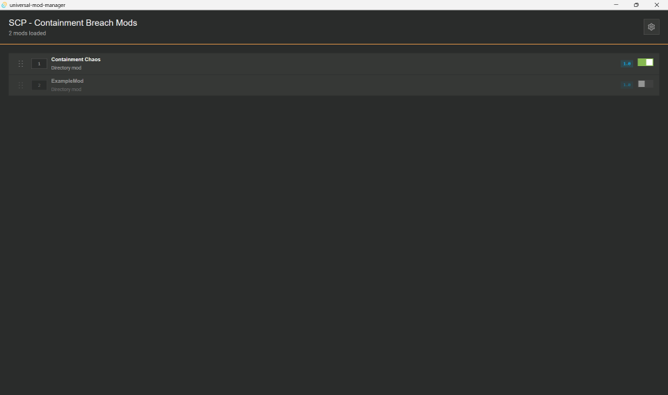
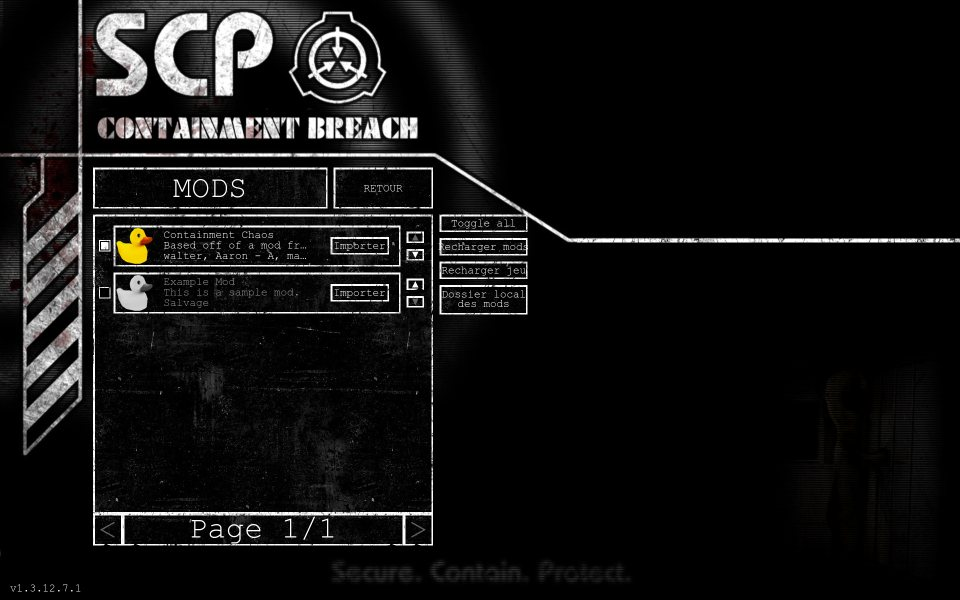
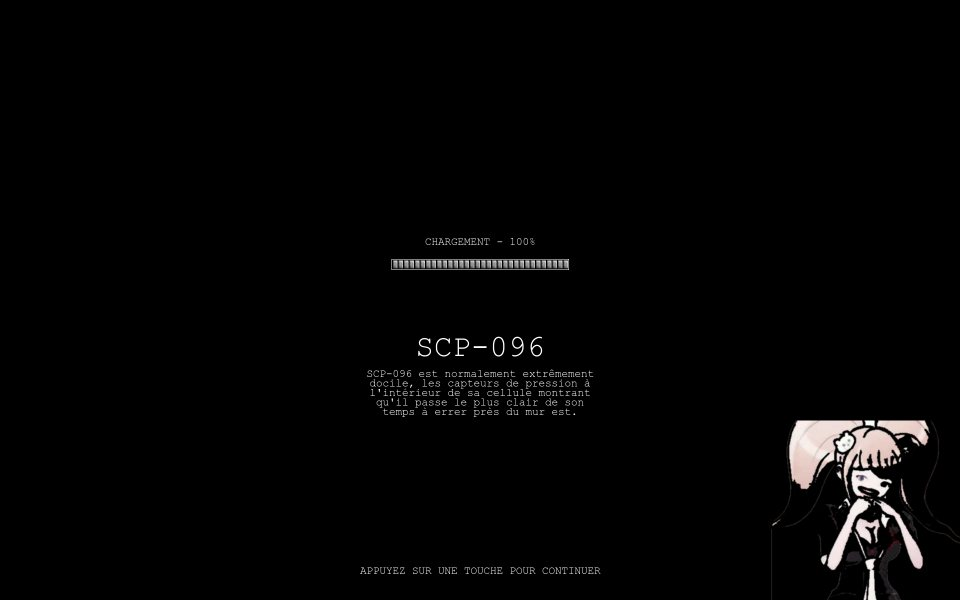

# UMM plugin example: TypeScript

A game plugin for [Universal Mod Manager](https://github.com/Universal-Mod-Manager/desktop) (UMM), written in
TypeScript with the [Extism JS PDK](https://github.com/extism/js-pdk). It manages the mods of
[SCP - Containment Breach](https://store.steampowered.com/app/2178380), a free single-player horror game with
official mod support. Other languages are listed on the
[`main` branch](https://github.com/Universal-Mod-Manager/plugin-example). The
[`rust` branch](https://github.com/Universal-Mod-Manager/plugin-example/tree/rust) implements the same plugin and
produces the same output.

## What the plugin does

| Plugin API v2 field | Value |
|---|---|
| Path roots | `game`: the install folder, which holds the `Mods` directory. `app_data`: `%APPDATA%\Undertow Games\SCP - Containment Breach`, which holds `options.ini` and `mods.ini`. |
| Mod discovery | Every folder in `game/Mods`. The folder name is the mod id. |
| Load-order write | `app_data/mods.ini` |

`build_load_order` writes one line per mod, sorted by UMM priority. `1` enables the mod, `0` disables it:

```ini
local HD Loading Screens=1
local Extra Items=1
local Old Textures=0
```

The game loads mods from top to bottom, so a mod overrides the files of the mods above it. The `local ` prefix is
how the game names mods from its `Mods` folder. The format comes from `ModManager.bb` in the
[v1.3.12 source](https://github.com/q8j-dev/SCP-Containment-Breach-Web/tree/main/upstream-scpcb), the version
released on Steam.

## How it is built

UMM runs WebAssembly, not JavaScript. The build turns the TypeScript code into a Wasm module in two steps:

1. [esbuild](https://esbuild.github.io) bundles `src/index.ts` into a single CommonJS file, `build/index.js`.
2. `extism-js` packs that file with [QuickJS](https://bellard.org/quickjs/), a small JavaScript engine, into
   `build/plugin.wasm`. It reads `src/index.d.ts` to know which functions to export.

QuickJS supports JavaScript up to ES2020, so the bundle targets ES2020. The engine is why the module weighs about
2.5 MB, against about 230 KB for the Rust version.

## Project layout

| File | Role |
|---|---|
| `src/index.ts` | The two exports, `get_game_metadata` and `build_load_order` |
| `src/index.d.ts` | Declares the Wasm exports for `extism-js` |
| `test/plugin.test.mjs` | Loads `build/plugin.wasm` through Extism, the runtime UMM uses, and checks both exports |
| `metadata.json` | Read by UMM to find the plugin name, its `.wasm` file and its icon |
| `Dockerfile` | Type-checks, builds and tests the plugin without a local toolchain |

## Build

With Docker (nothing else to install):

```sh
docker build --output dist .
```

The image downloads `extism-js` and Binaryen for x86_64 Linux.

Without Docker, install [`extism-js`](https://github.com/extism/js-pdk#install) and
[Binaryen](https://github.com/WebAssembly/binaryen/releases) (`wasm-merge` and `wasm-opt` on your `PATH`), then:

```sh
npm ci
npm run typecheck
npm run build
npm test
```

The module is written to `build/plugin.wasm`. Put it next to `metadata.json` and `icon.png`.

## Install in UMM

Copy the plugin folder (`dist/` with Docker) to UMM's plugin directory, then restart UMM:

- Windows: `%APPDATA%\com.umm.universal-mod-manager\plugins\scpcb\`
- Linux: `~/.local/share/com.umm.universal-mod-manager/plugins/scpcb/`

In UMM, select SCP - Containment Breach and point the two path roots to the install folder and to
`%APPDATA%\Undertow Games\SCP - Containment Breach`.

## Try it in game

1. Install [SCP - Containment Breach](https://store.steampowered.com/app/2178380) from Steam (free, about 400 MB) and
   launch it once so it creates its data folder.
2. Turn mods on in the game options (`enable mods` in `options.ini`).
3. The game ships with `Mods\ExampleMod`. For a second mod, create a folder in `Mods` with an `info.ini` containing
   `name=My Test Mod`.
4. In UMM, disable or reorder the mods, then open the Mods menu in the game: it shows the same state and order.

## Screenshots

Containment Chaos is enabled and ExampleMod disabled in UMM, and the game's Mods menu shows the same:

| UMM | Game |
|---|---|
|  |  |

With Danganronpa SCP Mod from [Nexus Mods](https://www.nexusmods.com/scpcontainmentbreach) enabled in UMM, the game
shows the mod's loading screen:



## Limits

- Mods subscribed on the Steam Workshop live in Steam's own folder and the game names them by Workshop id, so UMM
  does not see them. After UMM rewrites `mods.ini`, the game lists them as new, disabled mods.
- UMM shows folder names: the game describes mods in `info.ini`, and UMM only reads JSON metadata files.
