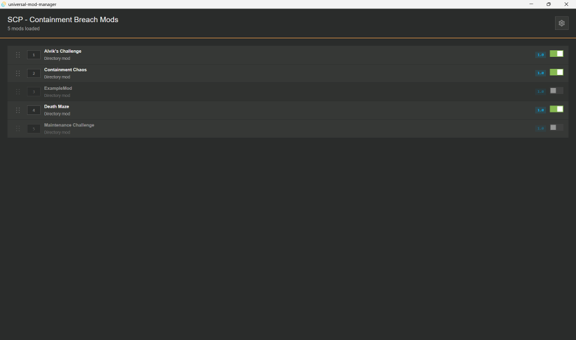
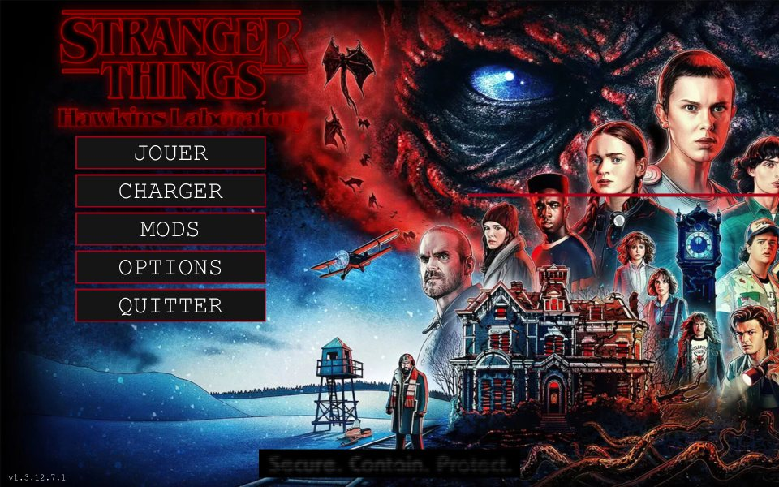

# UMM plugin example: Rust

A game plugin for [Universal Mod Manager](https://github.com/Universal-Mod-Manager/desktop) (UMM), written in Rust
with the [Extism Rust PDK](https://github.com/extism/rust-pdk). It manages the mods of
[SCP - Containment Breach](https://store.steampowered.com/app/2178380), a free single-player horror game with
official mod support. Other languages are listed on the
[`main` branch](https://github.com/Universal-Mod-Manager/plugin-example).

## What the plugin does

| Plugin API v2 field | Value |
|---|---|
| Path roots | `game`: the install folder, which holds the `Mods` directory. `app_data`: `%APPDATA%\Undertow Games\SCP - Containment Breach`, which holds `options.ini` and `mods.ini`. |
| Mod discovery | Every folder in `game/Mods`. The folder name is the mod id. |
| Load-order write | `app_data/mods.ini` |

`build_load_order` writes one line per mod, sorted by UMM priority. `1` enables the mod, `0` disables it:

```ini
local HD Loading Screens=1
local Extra Items=1
local Old Textures=0
```

The game loads mods from top to bottom, so a mod overrides the files of the mods above it. The `local ` prefix is
how the game names mods from its `Mods` folder. The format comes from `ModManager.bb` in the
[v1.3.12 source](https://github.com/q8j-dev/SCP-Containment-Breach-Web/tree/main/upstream-scpcb), the version
released on Steam.

## Project layout

| File | Role |
|---|---|
| `src/lib.rs` | The two exports, `get_game_metadata` and `build_load_order`, and unit tests |
| `metadata.json` | Read by UMM to find the plugin name, its `.wasm` file and its icon |
| `Dockerfile` | Tests and builds the plugin without a local Rust install |

## Build

With Docker (nothing else to install):

```sh
docker build --output dist .
```

With a local Rust toolchain:

```sh
rustup target add wasm32-unknown-unknown
cargo test
cargo build --release --target wasm32-unknown-unknown
```

The module is written to `target/wasm32-unknown-unknown/release/scpcb_plugin.wasm`. Rename it to `plugin.wasm`
and put it next to `metadata.json` and `icon.png`.

## Install in UMM

Copy the plugin folder (`dist/` with Docker) to UMM's plugin directory, then restart UMM:

- Windows: `%APPDATA%\com.umm.universal-mod-manager\plugins\scpcb\`
- Linux: `~/.local/share/com.umm.universal-mod-manager/plugins/scpcb/`

In UMM, select SCP - Containment Breach and point the two path roots to the install folder and to
`%APPDATA%\Undertow Games\SCP - Containment Breach`.

## Try it in game

1. Install [SCP - Containment Breach](https://store.steampowered.com/app/2178380) from Steam (free, about 400 MB) and
   launch it once so it creates its data folder.
2. Turn mods on in the game options (`enable mods` in `options.ini`).
3. The game ships with `Mods\ExampleMod`. For a second mod, create a folder in `Mods` with an `info.ini` containing
   `name=My Test Mod`.
4. In UMM, disable or reorder the mods, then open the Mods menu in the game: it shows the same state and order.

## Screenshots

Tested with mods downloaded from [Nexus Mods](https://www.nexusmods.com/scpcontainmentbreach). Maintenance Challenge
is disabled in UMM, so the game doesn't list its map:

| UMM | Game |
|---|---|
|  |  |

Hawkins Laboratory is enabled in UMM, so the game shows its main menu:

| UMM | Game |
|---|---|
|  |  |

## Limits

- Mods subscribed on the Steam Workshop live in Steam's own folder and the game names them by Workshop id, so UMM
  does not see them. After UMM rewrites `mods.ini`, the game lists them as new, disabled mods.
- UMM shows folder names: the game describes mods in `info.ini`, and UMM only reads JSON metadata files.
