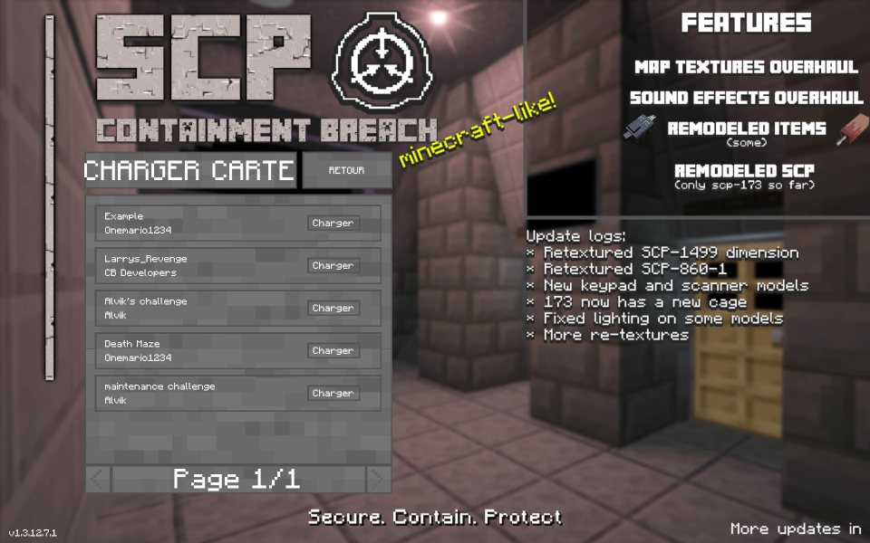
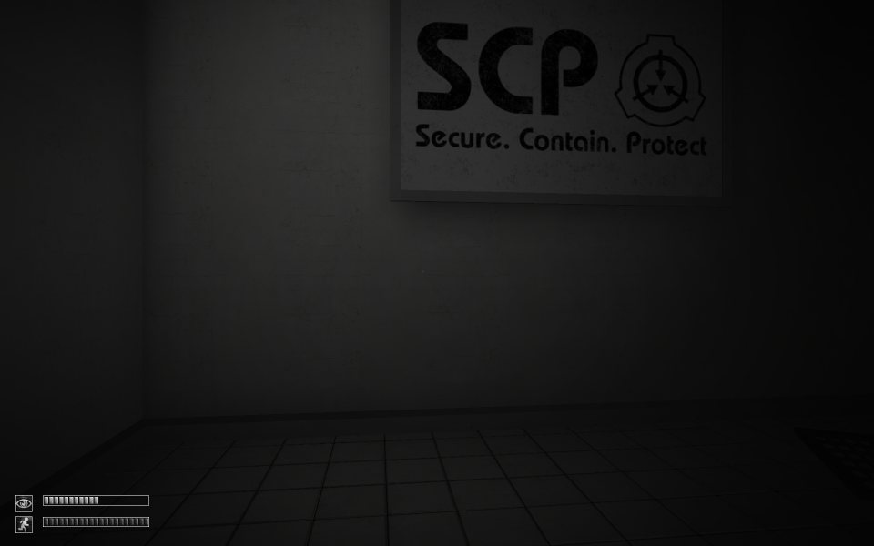
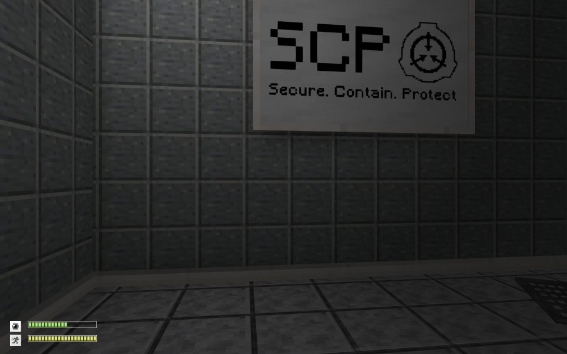

# UMM plugin example: Python

A game plugin for [Universal Mod Manager](https://github.com/Universal-Mod-Manager/desktop) (UMM), written in Python
with the [Extism Python PDK](https://github.com/extism/python-pdk). It manages the mods of
[SCP - Containment Breach](https://store.steampowered.com/app/2178380), a free single-player horror game that
supports mods. Other languages are listed on the
[`main` branch](https://github.com/Universal-Mod-Manager/plugin-example). The
[`rust`](https://github.com/Universal-Mod-Manager/plugin-example/tree/rust) and
[`typescript`](https://github.com/Universal-Mod-Manager/plugin-example/tree/typescript) branches implement the same
plugin and produce the same output.

## What the plugin does

| Plugin API v2 field | Value |
|---|---|
| Path roots | `game`: the install folder, which holds the `Mods` directory. `app_data`: `%APPDATA%\Undertow Games\SCP - Containment Breach`, which holds `options.ini` and `mods.ini`. |
| Mod discovery | Every folder in `game/Mods`. The folder name is the mod id. |
| Load-order write | `app_data/mods.ini` |

`build_load_order` writes one line per mod, sorted by UMM priority. `1` enables the mod, `0` disables it:

```ini
local HD Loading Screens=1
local Extra Items=1
local Old Textures=0
```

The game loads mods from top to bottom, so a mod overrides the files of the mods above it. The `local ` prefix is
how the game names mods from its `Mods` folder. The format comes from `ModManager.bb` in the
[v1.3.12 source](https://github.com/q8j-dev/SCP-Containment-Breach-Web/tree/main/upstream-scpcb), the version
released on Steam.

## How it is built

UMM runs WebAssembly, and Python code can't be compiled to Wasm directly. `extism-py` packs the plugin with a Python
interpreter instead: it starts the interpreter, loads `src/plugin.py` and saves that state as `build/plugin.wasm`.
The functions marked with `@extism.plugin_fn` become the exports of the module.

The interpreter is why the module weighs about 11 MB, against about 2.5 MB for the TypeScript version and 230 KB for
the Rust version.

## Project layout

| File | Role |
|---|---|
| `src/plugin.py` | The two exports, `get_game_metadata` and `build_load_order` |
| `tests/test_plugin.py` | Loads `build/plugin.wasm` through Extism, the runtime UMM uses, and checks both exports |
| `requirements-test.txt` | The Extism Python SDK, used by the tests |
| `metadata.json` | Read by UMM to find the plugin name, its `.wasm` file and its icon |
| `Dockerfile` | Builds and tests the plugin without a local toolchain |

## Build

With Docker (nothing else to install):

```sh
docker build --output dist .
```

The image downloads `extism-py` and Binaryen for x86_64 Linux. `extism-py` has no Windows build, so on Windows use
Docker or WSL.

Without Docker, install [`extism-py`](https://github.com/extism/python-pdk#install-the-compiler) and
[Binaryen](https://github.com/WebAssembly/binaryen/releases) (`wasm-merge` and `wasm-opt` on your `PATH`), then:

```sh
mkdir -p build
extism-py src/plugin.py -o build/plugin.wasm
pip install -r requirements-test.txt
python -m unittest discover -s tests
```

The module is written to `build/plugin.wasm`. Put it next to `metadata.json` and `icon.png`.

## Install in UMM

Copy the plugin folder (`dist/` with Docker) to UMM's plugin directory, then restart UMM:

- Windows: `%APPDATA%\com.umm.universal-mod-manager\plugins\scpcb\`
- Linux: `~/.local/share/com.umm.universal-mod-manager/plugins/scpcb/`

In UMM, select SCP - Containment Breach and point the two path roots to the install folder and to
`%APPDATA%\Undertow Games\SCP - Containment Breach`.

## Try it in game

1. Install [SCP - Containment Breach](https://store.steampowered.com/app/2178380) from Steam (free, about 400 MB) and
   launch it once so it creates its data folder.
2. Turn mods on in the game options (`enable mods` in `options.ini`).
3. The game ships with `Mods\ExampleMod`. For a second mod, create a folder in `Mods` with an `info.ini` containing
   `name=My Test Mod`.
4. In UMM, disable or reorder the mods, then open the Mods menu in the game: it shows the same state and order.

## Screenshots

Tested with three maps from [Nexus Mods](https://www.nexusmods.com/scpcontainmentbreach) and
[SCPCB but Minecraft-like](https://steamcommunity.com/sharedfiles/filedetails/?id=3687714732) by aethermc225, copied
from the Steam Workshop into the game's `Mods` folder. They are all enabled in UMM, so the game lists the maps and
uses the Minecraft textures:

| UMM | Game |
|---|---|
|  |  |

The first room of the game, without and with the Minecraft mod:

| Without | With |
|---|---|
|  |  |

## Limits

- Mods subscribed on the Steam Workshop live in Steam's own folder and the game names them by Workshop id, so UMM
  does not see them. After UMM rewrites `mods.ini`, the game lists them as new, disabled mods.
- UMM shows folder names: the game describes mods in `info.ini`, and UMM only reads JSON metadata files.
- The Extism Python PDK is still young: version 0.1.5, released in April 2025, with builds for Linux and macOS only.
- Only pure Python packages work inside the plugin. Packages with native code can't be loaded.
